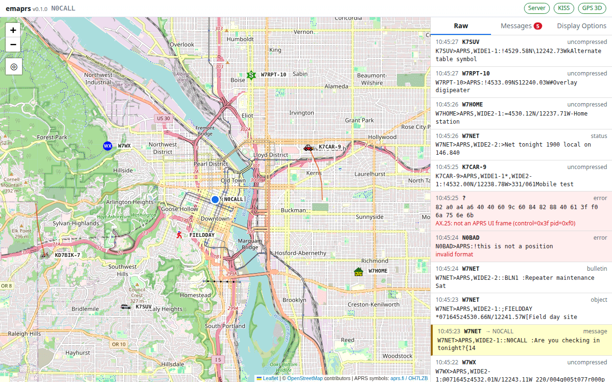
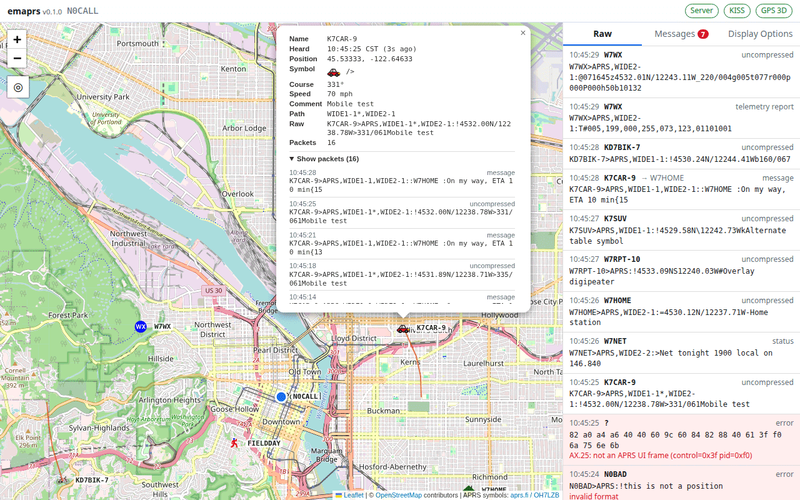
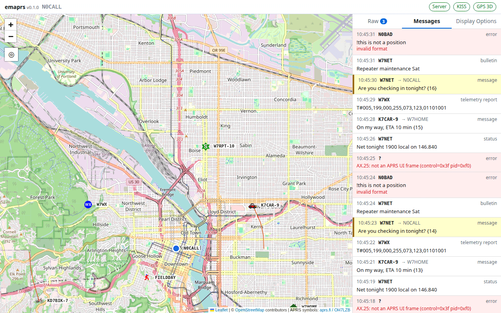
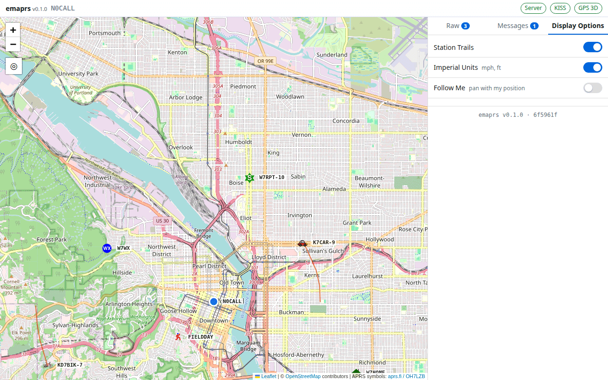

# emaprs - Embeddable APRS

A frontend for working with APRS. emaprs reads packets from a KISS-over-TCP
TNC (for example Direwolf) and your position from gpsd, then serves a web page
you open in any browser. It doesn't transmit yet; sending messages and other
packets is planned (see [Possible future work](#possible-future-work)).

The emaprs server doesn't need internet access, so it can run on a station
with only a local network, or none. Only the map tiles come from the
internet, and the browser fetches them itself when it can.



## Features

### Map

- Leaflet / OpenStreetMap map of heard stations, objects and items, drawn
  with the standard APRS symbol set (including overlay characters).
- Your own position as a blue marker, from gpsd or a fixed location in the
  config (see [Your position](#your-position-gpsd-or-a-fixed-location)).
  Packets you sent are ringed in blue.
- **Station trails**: a line through each moving station's earlier positions.
- The ◎ button re-centres the map on your position. The map centres on you
  automatically when your position first appears.
- Stations disappear after `station_expire_minutes` with no packets. Killed
  objects and items are removed right away.

### Header

- The emaprs version and your callsign.
- Status indicators for the **Server** (this page's connection to emaprs),
  the **KISS** TNC, and **GPS** (fix type, or that a fixed position is in use).
  Green means OK.

### Station popup

Click a station to see its latest details: when it was heard, position,
symbol, course, speed, altitude, comment, digipeater path and the raw packet.

The popup also shows how many packets are stored for that station (up to
twice `station_expire_minutes`, oldest dropped first). **Show packets**
expands a scrolling list of all of them, newest first, with time, packet
type and raw text. The list starts collapsed each time you open a popup and stays as you
leave it while the popup is open. The popup updates live while it is open.



### Raw tab

Every packet received, newest first, with its time, sender and decoded type.
Packets that failed to decode are shown in red with the reason, including
frames that aren't valid APRS (shown as hex). Click a packet that has a
position to jump to that station on the map. The tab badge counts packets
received while you're on another tab.

### Messages tab

Packets without a location: messages, bulletins, status reports, telemetry
and undecodable packets. Messages addressed to your callsign are
highlighted, and the tab badge turns red when one arrives while you're on
another tab. Messages expire after `station_expire_minutes`, like stations.



### Display Options tab

- **Station Trails** on/off switch.
- **Imperial Units** switch, on by default: speeds in mph and altitudes in
  feet; off shows km/h and metres. This only changes the display: emaprs
  stores and sends metric (aprslib converts APRS's knots and feet as it
  parses).
- **Follow Me** switch, off by default: the map pans to keep your position
  in the centre on every GPS update, at whatever zoom you have set. Without
  it the map centres on you only at the first fix (or when you press ◎).
- Your browser remembers each setting.
- The emaprs version and the git commit it was built from.



### Server

- Reconnects to the TNC and gpsd automatically, so either can start before
  or after emaprs.
- Keeps recent packets in memory, so a newly opened page shows the current
  map and lists right away. Live updates are pushed over a WebSocket.
- **Survives restarts**: every station's packet history is mirrored to a
  SQLite database as packets arrive and expire. On startup emaprs reloads it,
  drops anything past expiry, and rebuilds the map, Raw and Messages tabs.
  See [Packet database](#packet-database).
- Serves the map on every IPv4 and IPv6 address by default, or on just the
  addresses you list. See [Listening addresses](#listening-addresses).
- `emaprs --version` prints the version.
- A reference systemd unit ships in `contrib/systemd/`. See
  [Running as a service](#running-as-a-service).

## Install

```sh
python3 -m venv .venv
.venv/bin/pip install -e .          # add [dev] for the test tools: -e '.[dev]'
```

## Configure

```sh
mkdir -p ~/.config/emaprs
cp config.example.toml ~/.config/emaprs/emaprs.toml
vim ~/.config/emaprs/emaprs.toml
```

Without `--config`, emaprs reads `~/.config/emaprs/emaprs.toml`, or runs on
defaults if that file doesn't exist. Every key is documented in
`config.example.toml`. Unknown keys and bad values stop startup with an error.

### Your position: gpsd or a fixed location

Your own position (the blue "me" marker) comes from gpsd, from a fixed
location in the config, or both:

| `[gpsd] enabled` | `[station] position` | Your position on the map |
|---|---|---|
| `true` | empty | From gpsd. No marker until the first fix. |
| `true` | `[lat, lon]` | The fixed position until gpsd's first fix, then gpsd from then on |
| `false` | `[lat, lon]` | Always the fixed position. gpsd is never contacted. |
| `false` | empty | No own-position marker |

Example for a home station without GPS:

```toml
[station]
callsign = "N0CALL"
position = [45.52, -122.68]   # decimal degrees, north/east positive

[gpsd]
enabled = false
```

The GPS indicator in the page header shows which is in use:
- **Fixed position**: gpsd is disabled and the config position is shown.
- **GPS 3D** / **GPS 2D**: following gpsd.
- **GPS down · fixed pos** or **GPS no fix · fixed pos**: gpsd is enabled but
  hasn't had a fix yet, so the config position is shown.

Clicking the "me" marker also says whether the position is fixed or from GPS.

Once gpsd has had a fix, losing it keeps the last GPS position on the map.
It does not jump back to the fixed position.

### Packet database

```toml
[storage]
database = "~/.local/share/emaprs/emaprs.sqlite3"   # the default
# database = "/var/lib/emaprs/emaprs.sqlite3"       # e.g. a system service
```

If the key is left out, the default is `~/.local/share/emaprs/emaprs.sqlite3`
(under `$XDG_DATA_HOME` if set). The directory is created if needed. The
file always matches what's in memory: a packet is written when it arrives
and deleted when it expires, is pushed out by the per-station cap, or its
object is killed. If the file is unreadable (corrupt), emaprs renames it to
`*.bad-<time>` and starts empty instead of refusing to run.

To disable the database, set it to an empty string:

```toml
[storage]
database = ""
```

Nothing is then written to disk; packets live in memory only and history
starts empty after every restart. Removing the `database` line is not the
same thing: a missing key means the default path.

#### Flash wear on embedded devices

The database is written on **every received packet**: one SQLite commit
each, appended to the write-ahead log and periodically copied into the main
file, plus a delete about once a minute while packets expire. On a busy
channel that is tens of thousands of small writes a day. As a rough,
unmeasured estimate, around one packet a second can mean hundreds of MB to
over a GB written per day once SQLite's page-sized writes and the flash's
own erase-block overhead are counted.

That's harmless on an SSD or hard disk, but it wears out SD cards, cheap
eMMC and USB sticks quickly. Small writes are the worst pattern for them,
and a worn card fails, often by corrupting the filesystem. If emaprs runs
from such media, either:

- set `database = ""` and accept starting empty after a restart, or
- point `database` at durable storage: an SSD, industrial-grade eMMC or SD,
  or a disk.

Batching writes would reduce this; see [Possible future work](#possible-future-work).

Running under the shipped systemd unit, the database goes in
`/var/lib/emaprs/` instead; see [Running as a service](#running-as-a-service).

### Listening addresses

`[http] bind` is always a list of IP addresses. emaprs opens one listener
per address, all on `[http] port`. The default, `["0.0.0.0", "::"]`, is
every IPv4 and every IPv6 address; `config.example.toml` has examples for
this machine only, one LAN address, and IPv4 only.

- IP addresses only, not host names such as `localhost`.
- `0.0.0.0` already covers every IPv4 address and `::` every IPv6 one, so
  neither can be listed with a specific address of its own family.
- An empty list, a repeated address, or a plain string instead of a list
  (`bind = "0.0.0.0"`) is a config error. Configs from before this change
  used a string: write it as a list, e.g. `bind = ["0.0.0.0"]`.
- A specific address must be on an interface that is up when emaprs starts,
  or startup fails naming that address (under systemd, the unit retries).
- If IPv6 is disabled on the machine, any IPv6 address (`::`, `::1`, ...)
  stops startup with a message saying to remove it, e.g. to
  `bind = ["0.0.0.0"]`. That includes the default.

### Buffer sizes

`station_expire_minutes` (default 2880, two days) sets how long packets are
kept. It also sets the caps: each station's history and the Messages tab
hold at most twice that many packets (5760 by default). `raw_max` caps the
Raw tab. `messages_max` and `station_packets_max` from older configs are
ignored with a warning.

## Run

```sh
.venv/bin/emaprs                     # or: .venv/bin/python -m emaprs
.venv/bin/emaprs --config /path/to/emaprs.toml
```

Then open http://127.0.0.1:8080/ on the same machine, or
http://<this machine's address>:8080/ from another one (or whatever `[http]`
is set to). By default emaprs listens on every IPv4 and IPv6 address. The
page has no login, so anyone who can reach that port can view it; set
`[http] bind = ["127.0.0.1", "::1"]` to allow only this machine (see
[Listening addresses](#listening-addresses) and [Security](#security)). If
the KISS TNC or gpsd is not reachable, emaprs keeps retrying and the header
shows their status.

For Direwolf, enable its KISS TCP port in `direwolf.conf`:

```
KISSPORT 8001
```

## Running as a service

emaprs ships a reference systemd unit, `contrib/systemd/emaprs.service`.
`pip install` doesn't install it; copy it into place yourself (or have your
package or build recipe install it). Every setting in it is explained in
comments in the file.

### Install

```sh
sudo cp contrib/systemd/emaprs.service /etc/systemd/system/
sudo mkdir -p /etc/emaprs
sudo cp config.example.toml /etc/emaprs/emaprs.toml
sudo vim /etc/emaprs/emaprs.toml        # callsign, TNC, gpsd/position, http
sudo systemctl daemon-reload
sudo systemctl enable --now emaprs
journalctl -u emaprs -f
```

Packages and build recipes (e.g. a BitBake recipe with `inherit systemd`)
should install the unit to `/usr/lib/systemd/system/emaprs.service` instead.

### The database under the service

The unit runs emaprs as a throwaway system user (`DynamicUser`) with a
persistent `/var/lib/emaprs/`, and points emaprs's default database path
there. In `/etc/emaprs/emaprs.toml`, either leave `[storage] database` out
or set it to `/var/lib/emaprs/emaprs.sqlite3`. The example config's
`"~/.local/share/..."` line must be removed or changed: the service user has
no home directory, so emaprs would fail to open the database.

### Customising

Don't edit the installed unit; `sudo systemctl edit emaprs` opens a drop-in,
which survives upgrades. For a virtualenv install, override the command. The
empty `ExecStart=` line is required to clear the original first:

```ini
[Service]
ExecStart=
ExecStart=/opt/emaprs/.venv/bin/emaprs --config /etc/emaprs/emaprs.toml
```

The comments in the unit file cover the rest: why it has no `After=` or
`Requires=` lines and how to order it after Direwolf or gpsd on the same
machine, restart behaviour (a config error is not retried), the hardening
settings, keeping the database somewhere else, and images with a read-only
or RAM-backed `/var`.

## Security

emaprs is **not meant to be reachable from the internet**; don't expose it
directly. There is currently **no login, by design**: anyone who can reach
its port can see everything on the page (and, once sending is added, send
through your TNC). Use it at your own risk, and secure it as you see fit for
your network. To report a problem, open an issue. See
[SECURITY.md](SECURITY.md) for the details.

## Development

Setting up, running emaprs against fake radio and GPS servers, the checks
to run before committing, regenerating the screenshots and building
packages are all in [CONTRIBUTING.md](CONTRIBUTING.md), along with what
fits the project and its coding conventions. What changed in each release
is in [CHANGELOG.md](CHANGELOG.md); how releases are made is in
[RELEASING.md](RELEASING.md).

## Possible future work

- **Composing and sending packets.** Write APRS packets in the page and
  send them through the TNC: messages, bulletins, announcements, status
  reports, and objects and items (things other than your own station).
  Your own position report is left to the TNC, since most stations already
  beacon with Direwolf.
  - *Open question:* whether to also compose telemetry, weather reports
    and queries. Not decided yet.
- **Distance rings when no map is available.** When the browser can't load
  map tiles (no internet), draw distance rings around your position with
  north marked, so stations still show at the right distance and bearing.
- **Batched database writes.** Today every packet is its own SQLite commit
  (see [Flash wear](#flash-wear-on-embedded-devices)). A setting such as
  `[storage] flush_minutes = 30` could collect packets in memory and write
  them in one commit every 30 minutes (and on a clean shutdown). APRS
  traffic is slow and history is kept for days, so losing up to half an
  hour of packets in a crash or power cut costs little, while writes drop
  from one per packet to about 48 a day (plus expiry deletes, which could
  go in the same commit). That would make the database practical on
  SD-card devices.

## License

Copyright (C) 2026 Nicholas Heath

emaprs is free software: you can redistribute it and/or modify it under the
terms of the GNU General Public License as published by the Free Software
Foundation, either version 3 of the License, or (at your option) any later
version.

emaprs is distributed in the hope that it will be useful, but WITHOUT ANY
WARRANTY; without even the implied warranty of MERCHANTABILITY or FITNESS FOR A
PARTICULAR PURPOSE. See the GNU General Public License for more details.

You should have received a copy of the GNU General Public License along with
emaprs, in the file [LICENSE](LICENSE). If not, see
<https://www.gnu.org/licenses/>.

### Third-party files (not covered by the GPL)

- **APRS symbol graphics** in `emaprs/static/symbols/` come from the aprs.fi
  symbol set by Heikki Hannikainen, OH7LZB
  (<https://github.com/hessu/aprs-symbols>). They are a separate work bundled
  with emaprs and keep their own licenses, which differ from symbol to symbol:
  some are public domain, some CC BY-SA, some of unknown license, and a few are
  brand logos. See `emaprs/static/symbols/COPYRIGHT.md` for each one.
- **Leaflet** 1.9.4 in `emaprs/static/leaflet/` (BSD-2-Clause, © Volodymyr
  Agafonkin and CloudMade) is bundled so the page works offline. See
  `emaprs/static/leaflet/LICENSE`.
- **OpenStreetMap** map tiles (© OpenStreetMap contributors, ODbL) are
  loaded by the browser from their own servers. They are not part of this
  repository.
